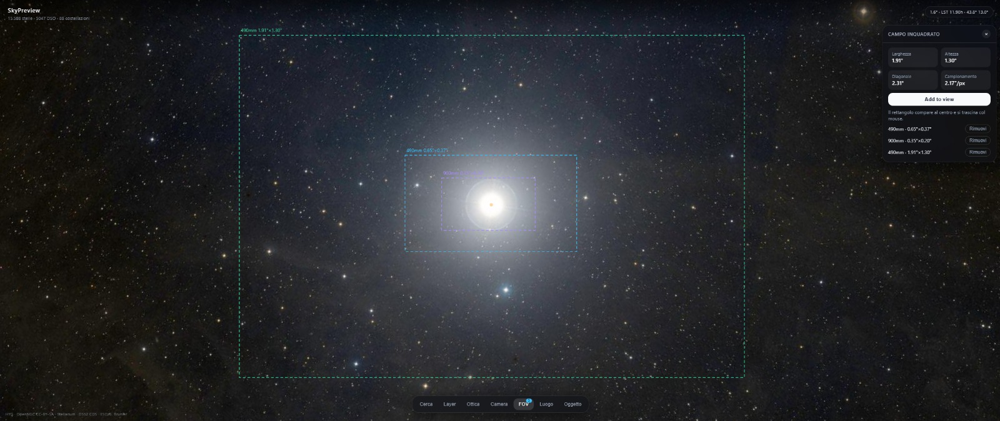

# SkyPreview



Minimal dark planetarium in the browser. Real star catalogs, real deep sky photos,
real telescope field-of-view math. No mock data.

## Features

- Fullscreen 3D-like perspective sky computed from your latitude, longitude, date and time
- Progressive deep sky photos from CDS HiPS2FITS (DSS2 color): zoom in and resolution increases like a map
- 15,588 stars from the HYG database, 12,137 deep sky objects from OpenNGC, 88 constellations from Stellarium
- Floating dock: object search, layers and grids, telescope and Barlow setup, camera setup, field of view, location
- Telescope FOV calculator from focal length, aperture, Barlow, sensor resolution and pixel size, with a draggable overlay on the sky
- DSS2 cutout preview for the selected object with a link to Aladin Lite

## Quickstart

Requirements: Node.js 20+.

```bash
npm install
npm run download:data
npm run dev
```

Production build:

```bash
npm run build
npm run preview
```

`npm run download:data` fetches the real catalogs into `public/data` and the
all-sky photo into `public/surveys`. It also runs automatically before every build.

## Data sources

| Data | Source | License |
| --- | --- | --- |
| Stars | HYG database mirror (Hipparcos, Yale Bright Star, Gliese) | Use with attribution |
| Deep sky objects | OpenNGC by Mattia Verga | CC-BY-SA-4.0 |
| Constellation lines | Stellarium western sky culture | GPL-2.0 |
| Deep sky photos | CDS HiPS2FITS, DSS2 color | For research and education |
| Milky Way panorama | ESO/S. Brunier (eso0932a) | CC BY 4.0 |

## Project structure

Every module lives in its own folder with a single responsibility.

```text
scripts/download-data.mjs      downloads and converts the real catalogs
src/components/App            root layout
src/components/SkyView        3D perspective viewport, layers, FOV overlay
src/components/Dock           floating control dock
src/components/SearchPanel    object search over the real catalogs
src/components/DisplayControls layers, grids, photo toggles, zoom
src/components/OpticsPanel     telescope focal length, aperture, Barlow
src/components/CameraPanel     sensor resolution and pixel size
src/components/FovPanel        computed field of view plus Add to view
src/components/LocationPanel   geographic position, date and time
src/components/ObjectDetail    DSS2 preview of the selected object
src/hooks                     useSkyView, useObserver, useFovSetup, useHipsBackground
src/services/astroMath        sidereal time, AltAz conversions
src/services/catalog          runtime catalog loading and search
src/services/fov              field of view math
src/services/hips             HiPS2FITS progressive photo cutouts
src/services/survey           DSS and Aladin Lite links
src/services/viewProjection   perspective projection math
src/store/skyStore            shared UI and observer state
```

## Deploy

Pushing to `main` deploys to GitHub Pages through `.github/workflows/deploy.yml`.
The build uses relative asset paths, so any Pages URL works.
